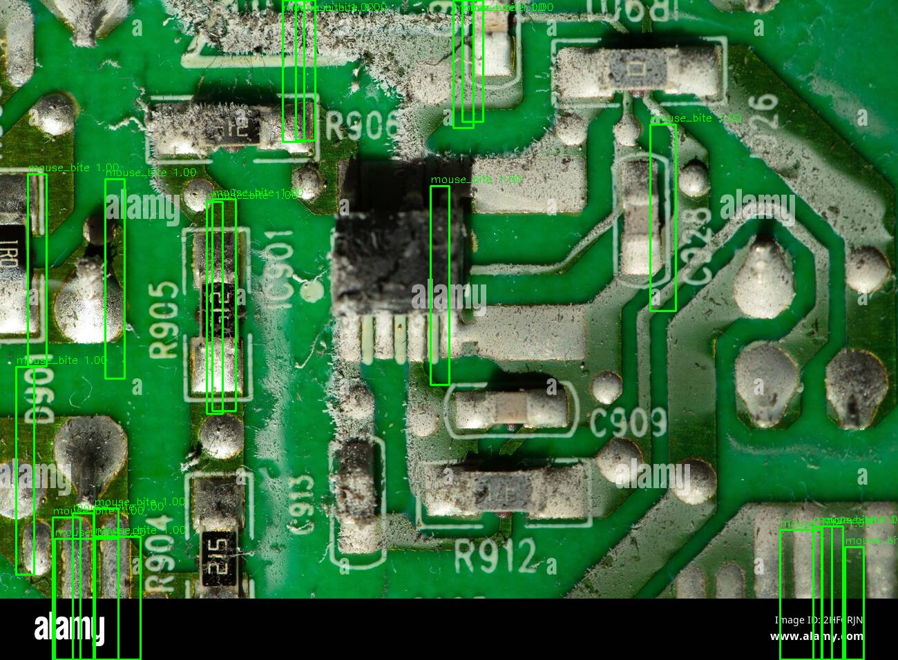

# Dual-Pipeline Industrial PCB Quality Control (Edge AI)

**Bharat AI-SoC Challenge 2026–27 — Phase 1 Submission**  
**Theme:** Manufacturing & Industry 4.0 — Real-Time Industrial Defect Detection & Quality-Control Assistant

## Overview
An air-gapped, on-device industrial quality-control assistant deployed on an **NVIDIA Jetson Nano 4 GB (Arm Cortex-A57, aarch64)**. The pipeline combines 10-class YOLO PCB defect detection with an offline LoRA fine-tuned **TinyLlama-1.1B** repair advisor that outputs severity, root-cause analysis, and operator repair steps without cloud dependence.

## Repository Structure
- `src/` — Stage 1 YOLO inference (`run_batch.py`), Stage 2 offline LLM advisor (`run_llama_advisor.py`), and end-to-end offline launcher (`run_full_pipeline.sh`)
- `outputs/` — Annotated inspection output (`out_1.jpg`), structured detection log (`detections.csv`), and offline repair guidance (`repair_guidance.txt` / `.json`)
- `docs/` — Phase 1 Technical Report PDF

## Edge Execution Proof (100% Offline)
- **Hardware:** NVIDIA Jetson Nano 4 GB (VVDN Carrier Board), 128 GB NVMe SSD, Ubuntu 18.04 (L4T R32.7.6) + ARM64 Python 3.11 Docker runtime
- **Network Isolation:** Verified with `ping 8.8.8.8` -> `Network is unreachable`

## Deliverables
- **Technical Report:** See [`docs/`](docs/)
- **Demonstration Video:** [PASTE YOUR YOUTUBE UNLISTED OR GOOGLE DRIVE LINK HERE]
- **Team:** [ADD YOUR NAME AND TEAMMATE NAME(S)]
